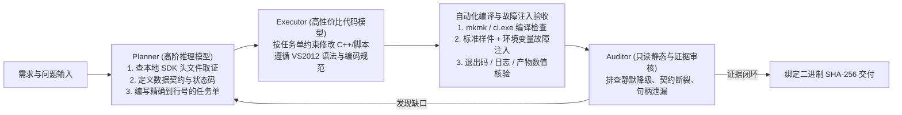

# CATIA CAA 智能体（Agent）开发思路与工程踩坑总结

本文档总结了在 Windows + CATIA V5 CAA（C++ Component Application Architecture）环境下，采用大语言模型智能体（Agent）进行原生几何提取、批处理自动化及桌面端工程软件开发的方法论与实战踩坑记录。

文中案例源自 [CATIA BOM 导出工具](https://github.com/90winter/catia-bom-export-by-caa) 的 V1 至 V4 迭代，所有具体问题均已抽象为可复用于其他 CAA 批处理、数据提取与插件开发项目的通用工程规范。

---

## 一、为什么用 AI 写 CAA 代码容易翻车？

在通用 Web 或现代 C++/Python 项目中表现良好的大模型，直接用于 CATIA CAA 开发时往往错误率极高，核心原因在于以下四点客观限制：

1. **公开语料匮乏且极易串台**
   - 模型训练语料中，VBA/COM 自动化接口（通常以 `CATIA*` 开头，基于 `IDispatch`）与原生 C++ CAA 接口（通常以 `CATI*` / `CATICGM*` 开头）经常混杂。两者并非改个前缀就能互换的关系。
   - CATIA V5 的文件式文档模型（`CATDocument` / `CATIPrtPart` / `CATIProduct`）与 V6 / 3DEXPERIENCE 的 PLM 对象模型（Reference / Instance / Occurrence / Representation）架构完全不同。模型凭自然语言猜出的接口名、方法签名和头文件路径，十有八九在本地 SDK 中根本不存在。
2. **工具链代差与构建机制特殊**
   - CAA 强绑定特定版本的 RADE（`mkmk` / `tck_init`）与老旧 MSVC 编译器（例如 CATIA V5-6R2016 B26 绑定 VS2012 `v110` 工具集）。
   - 不支持现代 C++14/17/20 标准库特性，且对源文件编码（本项目的 UTF-8 源码使用 BOM）、Framework 依赖声明（`IdentityCard`）与模块链接声明（`Imakefile.mk`）有严格约束。
3. **原生 COM / CGM 生命周期脆弱**
   - CAA 混用了引用计数（`AddRef` / `Release`）、智能指针（`_var`）、几何工厂容器与会话管理。析构顺序稍有不当，就会在文档关闭或进程退出阶段触发 `0xC0000005`（Access Violation），造成“业务结果文件已生成，但进程崩溃返回非零退出码”。
4. **“能跑通正常样件”不等于“工程可用”**
   - 真实工业模型普遍包含隐藏特征（NoShow）、空几何体（Empty Body）、破损拓扑面、退化曲面或上千个实体。缺少异常隔离与显式状态表达的代码，一旦遇到非理想模型就会静默算错或无限挂起。

---

## 二、CAA 智能体协同开发思路（工作流设计）

针对上述痛点，我们在实践中收敛出一套 **“规范先行（Skill-First） + 规划与执行分离（Planner-Worker） + 独立挑刺审核（Auditor）”** 的开发模式。



### 1. 证据先行，严禁盲猜 API（API Discovery 原则）
在动手写任何 CAA C++ 代码前，必须先在目标机器已安装的 SDK 目录（`PublicInterfaces`）和随附文档（`CAADoc`）中完成静态取证，明确以下 6 项内容后再下发编码任务：
- **入口对象与上下文**：从哪个根对象（`CATDocument`、`CATIPrtContainer`、`CATGeoFactory`）出发？
- **获取方式**：通过 `QueryInterface`（对应 IID 是什么）、工厂函数还是服务类获取？
- **真实签名与返回值**：头文件中的确切参数类型、`HRESULT` 判定规则（注意区分 `S_OK` 与 `S_FALSE`）。
- **所有权与生命周期**：返回指针是调用方拥有（需 `Release` / `delete`）、智能指针 `_var` 托管，还是借用引用（严禁手动释放）？
- **所属 Framework 与模块**：头文件在哪个 Framework（写入 `IdentityCard`）？符号在哪个模块库（写入 `Imakefile.mk` 的 `LINK_WITH`）？
- **副作用边界**：只读提取任务严禁为了“拿到更多数据”而隐式调用 `Update`、`Save` 或修改活动文档。

### 2. 规划模型与执行模型分工（Planner + Executor）
- **规划与验收模型（Planner）**：负责全局架构、本地 SDK 头文件检索、跨模块数据流对齐、制定修改任务单（Task Spec）以及最终实机测试验证。任务单应具体到目标文件、函数签名、边界条件和禁止事项（避免把上下文耗费在反复试错上）。
- **代码执行模型（Executor）**：接收明确的任务单，在受控范围内完成 C++ 源码、构建脚本与导出逻辑的编写。
- **只读审核视角（Auditor）**：在阶段性完成后，不看“Happy Path”，专门以只读方式审查：**如果某个 API 失败了会怎样？前后端字段含义是否一致？超时或取消时会不会留垃圾？测试日志能不能证明结论？**

### 3. 架构铁律：轻量宿主 + 独立短期 CAA Worker 进程
对于所有 CAA 批处理、模型检查、几何/BOM 提取工具，**不要将 GUI 界面、报表生成与 CAA 原生调用耦合在同一个长生命周期进程内**。通用的稳健架构是：
- **宿主进程（Win32 UI / CLI）**：负责参数校验、创建隔离临时目录、管理子进程生命周期（Job Object + 取消事件 + 心跳超时监控）、解析结构化回执，以及生成最终交付物（如 Excel / JSON）。
- **独立 CAA Worker 进程（`CAAStandalone*.exe`）**：单次运行只处理一个任务（或受控小批次），严格走完 `Create_Session` $\rightarrow$ `OpenDocument` $\rightarrow$ `业务提取与落盘` $\rightarrow$ `Remove` $\rightarrow$ `Delete_Session` 闭环后立即退出。即便遇到极端损坏模型引发底层崩溃，也只影响当前 Worker 子进程，不会冲垮主界面或污染后续任务。

---

## 三、通用踩坑清单与工程解法（从具体问题到通用模式）

以下 8 类问题是在真实开发与审核中反复暴露的典型陷阱，适用于几乎所有 CATIA CAA C++ 项目。

### 坑 1：COM 智能指针 `_var` 析构晚于会话销毁，导致进程退出阶段崩溃

- **具体现象**：Worker 已经把 CSV、图片等结果全部正确写出到磁盘，日志也打印到了最后一步，但在 `main()` 函数 `return 0` 时进程偶发崩溃（Exit Code 非零）。
- **根本原因**：`CATIPrtPart_var`、`CATLISTV(CATBaseUnknown_var)` 等局部智能指针与 `CATDocumentServices::Remove(*doc)`、`Delete_Session("...")` 处于同一层函数作用域。当会话被销毁后，`main()` 函数栈展开才开始调用这些局部 `_var` 的析构函数，此时内部触发 `Release()` 访问了已被销毁的文档内存。
- **通用解法**：
  1. **强制内层作用域隔离**：用显式的 `{ ... }` 作用域块包裹所有业务期的 CAA 智能指针、列表容器和接口查询，确保在调用 `CATDocumentServices::Remove` 和 `Delete_Session` **之前**，所有模型对象引用已 100% 析构完毕。
  2. **单一清理出口**：不要在多个 `if (...) return 1;` 分支里复制粘贴 `Remove` 和 `Delete_Session` 代码，统一收敛到函数末尾或结构化清理逻辑中，避免重复关闭或漏关。

```cpp
// 推荐范式：用内层作用域确保智能指针在关闭文档前析构
CATDocument* pDoc = NULL;
HRESULT rc = CATDocumentServices::OpenDocument(inputPath, pDoc, TRUE /*只读*/);
if (SUCCEEDED(rc) && pDoc != NULL) {
    {
        // 所有 _var 智能指针与业务容器限定在此作用域内
        CATIPrtContainer_var spPrtCont = ...;
        CATIPrtPart_var spPart = ...;
        // ... 执行几何测量与数据写出 ...
    } // <--- 离开此作用域时，所有 _var 已安全析构完毕

    CATDocumentServices::Remove(*pDoc);
    pDoc = NULL;
}
Delete_Session(sessionName);
```

---

### 坑 2：用标准 C++ `try/catch` 捕不住 CAA 原生异常，且异常分支易漏释放资源

- **具体现象**：面对存在拓扑缺陷、退化面或无效几何体的模型时，调用 CGM 测量（如 `CATICGMDynMassProperties3D`）或离屏渲染（`CATVisManager` / `CAT3DViewer`）直接导致进程异常终止，外层的标准 C++ `try { ... } catch (...)` 未能拦截，或拦截后发生了可视化对象与内存泄漏。
- **根本原因**：CATIA CAA 拥有一套自有的异常宏机制（基于 `CATError`），许多底层模块抛出的是 CAA 异常而非标准 C++ 异常；同时异常跳转会绕过常规的释放语句。
- **通用解法**：
  1. 在所有可能失败的 CGM 几何计算、拓扑遍历、离屏渲染原语外层，显式使用 **`CATTry` / `CATCatch(CATError, err)` / `CATEndTry`**。
  2. 在 `CATCatch` 块中提取并记录 `err->GetMsgId()`、`err->GetNLSMessage()`、源码文件与行号，随后调用 `Flush(err)`。
  3. 严格按创建的反向顺序释放临时挂载的视图与渲染资源（例如先断开 `CATVisManager::detachFrom`，再释放 `CATI3DGeoVisu`，最后销毁 `CAT3DViewpoint` / `CATOffScreenViewer`）。

---

### 坑 3：“静默降级”掩盖局部失败，甚至导致下游逻辑误判

- **具体现象**：
  - **案例 A（默认值引发误归并）**：为防止异形件误合并，增加了主惯性矩特征值（`eig1, eig2, eig3`）比对。当某两个不同形状的实体因几何缺陷导致惯性测量双双失败时，特征值均保留为初始值 `0, 0, 0`。旧版在惯性矩无效时会跳过这项比较，体积和面积仍符合容差的异形件就可能被归并。
  - **案例 B（笼统警告误导用户）**：Worker 内部对微小体过滤、空 Body、表面积回退计算、离屏截图失败生成占位图都执行了 `warnings++`，而主程序看到 `warnings > 0` 就统一弹窗提示“已自动筛除小于 1 mm³ 的微小体”，导致用户拿到了含占位图或面积异常的报表却毫不知情。
- **根本原因**：**把“降级容错”写成了“静默伪装成正常数据”**——用默认零值代替了显式的有效性标志（Validity Flag），用单一计数器代替了分类状态。
- **通用解法**：
  1. **携带显式有效位**：测量结果结构体必须包含独立的布尔有效位（如 `bool inertiaOk`、`bool renderOk`）。在任何等价性归并或下游计算中，只要任一侧 `!ok`，必须遵循**保守原则**（直接返回“不可归并/单列处理”），绝不允许用默认零值参与比对。
  2. **正交拆分警告与组合状态**：
     - 日志汇总必须输出分项计数（如 `warning_breakdown tiny=0 empty_body=1 area_warning=0 render_fallback=2 inertia_fallback=1`）。
     - 单个对象同时触发多种非致命警告时，状态标识应支持拼接组合（如 `area_warning+render_warning`），避免后发状态覆盖前序状态。
     - 交付物（如 Excel / 报告）中应自动生成独立的《异常与警告明细》表，将非 `ok` 实体的名称、状态码与原因完整透出。

---

### 坑 4：跨进程 / 多引擎链路的“数据契约断裂”（Contract Drift）

- **具体现象**：
  - 给命令行和 UI 增加了“自定义密度”参数并传给了 CAA Worker，Worker 也算出了正确的实例质量写入 CSV；但下游生成 Excel 的模块（或 Node.js 与原生 C++ 双引擎中的某一个）漏接了该参数，导致最终交付的 Excel 仍按默认材料密度计算公式。
  - 检测到隐藏实体（NoShow）提前终止时，分支内部打印了一行 `failures=1`，而函数末尾收口处又打印了一行 `failures=0`，导致同一份日志里出现自相矛盾的终态标记。
- **根本原因**：智能体在修改跨文件、跨语言边界的功能时，容易只完成“局部点修改”，忽略了从输入端到最终交付单元格的全链路追踪。
- **通用解法**：
  1. **终态日志唯一出口**：`status=`、`warnings=`、`failures=` 等供宿主解析的协议字段，全文件只能有一处最终输出点；中途分支只修改状态变量，不直接打印终态行。
  2. **全链路契约追踪表**：凡涉及跨进程参数（如单位、密度、容差、状态枚举），修改前先列出完整流向：`UI/CLI 入参 -> Worker 命令行 -> 中间 CSV 列定义 -> 宿主校验器 (validateRows) -> 导出引擎 A/B -> 最终公式与静态缓存值`，逐跳核对。

---

### 坑 5：把“业务日志增长”当成“存活心跳”，误杀重计算慢任务

- **具体现象**：宿主通过监控 Worker 日志文件大小是否变化来判断子进程是否卡死（例如 3 分钟无新日志即判定无响应并强杀）。当遇到复杂大装配体或包含大量曲面的实体时，单次 CGM 测量或高分辨率离屏渲染耗时可能超过 3 分钟，期间没有阶段性日志输出，导致正常工作的 Worker 被误杀。
- **根本原因**：混淆了“阶段完成事件（Stage Log）”与“进程存活心跳（Liveness Heartbeat）”。
- **通用解法**：
  - 在 CAA Worker 进程内启动一个极轻量的独立后台心跳线程（每 1~2 秒向 `heartbeat_<id>.txt` 写入当前毫秒时间戳与当前所处阶段名称，并在每次阶段切换时立即刷新）。
  - 宿主的超时监控循环优先检查 `heartbeat_<id>.txt` 的更新时间；若触发超时强杀，报错信息必须包含从心跳文件中读到的“最后所处阶段”与“已运行时间”，方便区分是慢任务还是死锁。

---

### 坑 6：Windows 子进程树残留、Job Object 假绑定与临时目录多层残留

- **具体现象**：
  - 用户点击“取消任务”或主程序异常关闭后，后台仍有 `CATSTART.exe`、`CNEXT.exe` 或 `CAAStandalone*.exe` 驻留，占用许可证与文件锁。
  - 任务结束后提示 `%TEMP%` 下的隔离缓存目录无法完全删除。
- **根本原因**：
  1. 使用 `CreateProcessW(..., CREATE_SUSPENDED, ...)` 启动子进程后，未严格检查 `SetInformationJobObject`、`AssignProcessToJobObject` 和 `ResumeThread` 的返回值。在受限环境或嵌套 Job 下绑定失败时，代码仍记录 `job_object=enabled`；或者 `ResumeThread` 失败时直接返回，留下一个永远挂起的僵尸进程。
  2. CATIA 运行时会在重定向的 `CATTemp` 目录下创建带只读属性的多级子目录（如 `CNext01.roll`），简单的单层文件删除无法清理。
- **通用解法**：
  1. **严格校验进程绑定与恢复**：`CreateJobObjectW`、`SetInformationJobObject(JOB_OBJECT_LIMIT_KILL_ON_JOB_CLOSE)`、`AssignProcessToJobObject`、`ResumeThread` 形成原子链条，任一步骤失败必须立即调用 `TerminateProcess(pi.hProcess, 1)` 并关闭所有句柄。
  2. **严禁按映像名全局杀进程**：取消任务时只能终止当前任务绑定的 Job Object 或已记录的 PID，**绝不能执行 `taskkill /F /IM CNEXT.exe`**，否则会直接杀死用户正在交互操作的 CATIA 主窗口。
  3. **全阶段覆盖取消信号**：不仅在等待子进程时检查 `cancelEvent`，在同步执行的后处理阶段（如原生 C++ 打包压缩 `.xlsx` 循环、最终 `CopyFileW` 发布结果前）也必须分段检查取消事件与总截止时间（Deadline Tick）。
  4. **递归清除只读属性并删除目录树**：临时目录清理函数必须支持递归遍历子目录，并在调用 `DeleteFileW` 前通过 `SetFileAttributesW(path, attrs & ~FILE_ATTRIBUTE_READONLY)` 移除只读标志。

---

### 坑 7：RADE / `mkmk` 构建与旧版 MSVC 的环境及编码陷阱

- **具体现象**：
  - 在 PowerShell 中分两次调用工具执行 `tck_profile` 和 `mkmk`，提示命令未识别或环境变量丢失。
  - 智能体用编辑工具修改了含中文提示的 `.cpp` / `.h` 文件后，原本能编译通过的代码在 VS2012 `cl.exe` 下突然报满屏 `warning C4819`、`error C2001: 常量中有换行符`、`error C2143: 缺少“)”`。
- **根本原因**：
  1. 每次独立的命令调用都会开启新的子进程，前一次设置的环境变量不会保留到下一次。
  2. 在中文 Windows（系统活动代码页为 CP936 / GBK）上，MSVC 2012 (`cl.exe` 17.00) 若读取到**不带 BOM 的 UTF-8** 源文件，会按 GBK 双字节编码去解码 UTF-8 字节流。源码被错误解码后，编译器可能报字符编码或语法错误。
- **通用解法**：
  1. **单进程串行初始化与构建**：必须在同一个 `cmd.exe /c` 会话内用 `call` 串联环境初始化与构建命令（例如 `call vcvarsall.bat amd64 && call tck_init.bat && ... && mkmk -u -g`）。若在受限沙箱内拿不到 RADE 许可，应通过宿主的沙箱外执行机制重试，而不是修改 C++ 代码去规避。
  2. **强制 UTF-8 with BOM (`EF BB BF`)**：在 `build.ps1` 构建脚本开头加入一段自动检查逻辑——扫描所有 `.cpp` / `.h` 文件头 3 个字节，若无 `EF BB BF` 则自动以 UTF-8 with BOM 重新写回，从根源上杜绝 `C4819` / `C2001` 编码报错：
     ```powershell
     $files = Get-ChildItem $SourceDir -Include *.cpp,*.h -Recurse
     foreach ($f in $files) {
         $bytes = [System.IO.File]::ReadAllBytes($f.FullName)
         if (-not ($bytes.Length -ge 3 -and $bytes[0] -eq 0xEF -and $bytes[1] -eq 0xBB -and $bytes[2] -eq 0xBF)) {
             $text = [System.IO.File]::ReadAllText($f.FullName, [System.Text.Encoding]::UTF8)
             [System.IO.File]::WriteAllText($f.FullName, $text, (New-Object System.Text.UTF8Encoding($true)))
         }
     }
     ```
  3. **最小化 Framework 依赖**：后台批处理 Worker 只保留几何、拓扑与必要的可视化模块，从 `IdentityCard` 与 `Imakefile.mk` 中剔除 `ApplicationFrame`、`MechanicalModelerUI` 等交互式 UI 模块，减少运行期 DLL 依赖面。

---

### 坑 8：异常分支缺少可控复现手段，导致降级代码“只写不测”

- **具体现象**：代码里写了惯性测量失败回退、离屏渲染失败重试与占位图生成、超时强杀等分支，但手头只有正常的 `.CATPart` 模型，无法稳定触发 CGM 或 OpenGL 报错，导致这些异常分支停留在“纸面正确”。
- **根本原因**：在 CATIA 中手工建模造出一个“恰好在特定 API 调用时抛异常”的模型成本极高。
- **通用解法**：
  - 在 Worker 关键原语处预埋**默认关闭、仅由环境变量激活的故障注入钩子（Fault Injection Hooks）**：
    - `CAA_FORCE_INERTIA_FAIL=1`：模拟主惯性矩提取失败，验证是否保守单列并输出 `inertia_warning`。
    - `CAA_FORCE_RENDER_FAIL=1`：模拟离屏截图失败，验证重试逻辑、占位图生成及 `render_warning` 提示。
    - `CAA_SIMULATE_DELAY_MS=5000`：在测量循环中注入受控延时，验证后台心跳刷新与取消/超时回收机制。
  - 这些钩子默认关闭。自动化验收时可设置对应变量并运行标准模型，逐条验证这些钩子覆盖的降级路径。

---

## 四、通用 CAA 项目交付与验收核对表（Checklist）

在结束任何 CAA 开发或修复任务前，建议对照下表逐项核验，**切勿将“编译退出码为 0”或“无参启动不报错”直接等同于功能验收通过**：

| 验收维度 | 必须确认的具体证据 | 常见假阳性陷阱 |
| :--- | :--- | :--- |
| **1. 编译与产物验证** | `mkmk` / `cl.exe` 退出码为 `0`，日志无 `# make-ERROR` / `# mkmk-FATAL`；核对目标 `.exe` / `.dll` 的最新修改时间与 **SHA-256 哈希**。 | 包装脚本吞掉内部错误码；或编译失败但目录里留有上一轮的旧二进制文件。 |
| **2. 几何数值独立核对** | 用已知理论值的标准几何体（如 $10\times10\times10\text{ mm}$ 正方体）实测，独立核对体积（$1000\text{ mm}^3$）、表面积（$600\text{ mm}^2$）、质心坐标及给定密度下的质量。 | 拿一个因包含隐藏体而被提前拦截（Exit Code 3）的标准件运行日志，误当成数值验证通过。 |
| **3. 归并与边界样件** | 覆盖：平移/旋转的同规格实体（应归并）、同体积不同形状的实体（不应归并）、惯性提取失败实体（应保守单列）。 | 只测试了单个实体或完全相同的阵列实体。 |
| **4. 异常与拦截路径** | 覆盖：含隐藏实体（NoShow）模型、微小体（$<1\text{ mm}^3$）、空 Body、以及通过环境变量注入的渲染/惯性失败，核对退出码、UI 提示文案与《异常与警告明细》表。 | 异常分支只写了代码，从未真正触发执行过。 |
| **5. 路径与环境鲁棒性** | 覆盖：含中文与空格的输入/输出路径、同名输出文件自动避让、只读文件输入、干净解压目录（不含开发机额外混入的系统 DLL）。 | 只在英文路径或带有额外残留 DLL 的编译目录下测试。 |
| **6. 进程与缓存清理** | 正常完成、报错退出、手动取消三种场景下，检查后台无残留 Worker / `CNEXT` 进程，`%TEMP%` 隔离目录已递归清理干净。 | 只看主界面关闭，未检查任务管理器后台进程与 `%TEMP%` 二级子目录。 |
| **7. 交付物与版本绑定** | 验收记录中明确绑定：输入样件、执行命令、退出码、输出文件及当前主程序与 Worker 的 SHA-256。 | 重新编译了主程序或修改了脚本后，仍沿用旧版本的测试结论。 |
